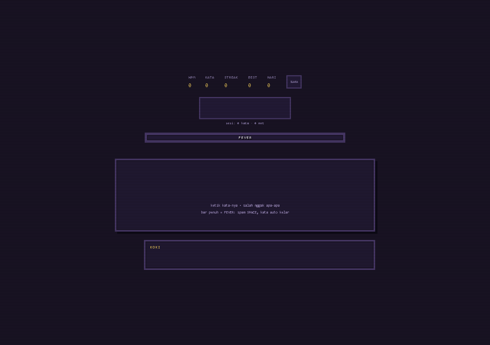
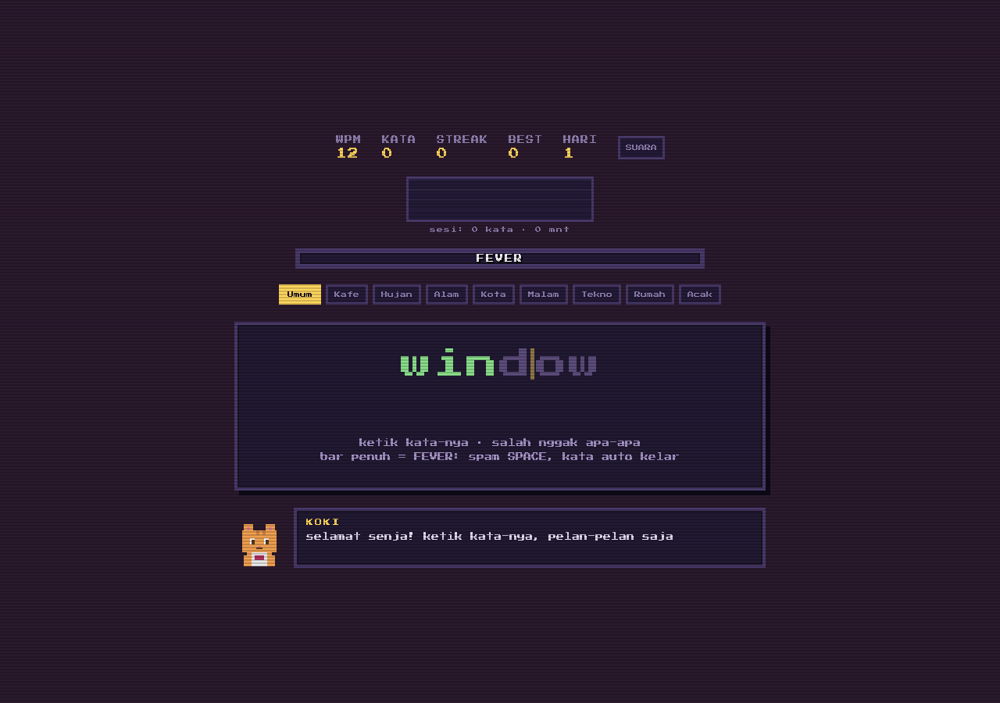
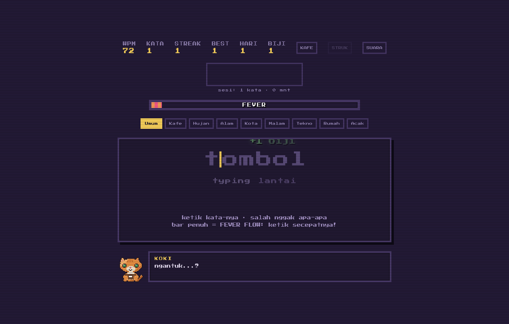
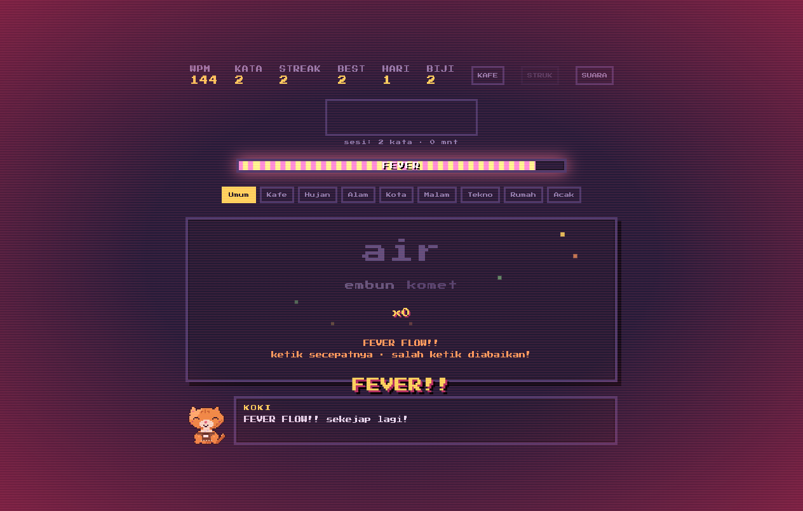

# Typing Fever

Chill pixel-art visual novel typing game. Ketik kata secepat dan selama mungkin tanpa objektif atau hukuman — isi bar **FEVER**, lalu nikmati **Espresso Flow Rush** di mana kamu tetap mengetik dan salah ketik diampuni.

**v1.2.0** · 2026-11-13 · [Changelog](docs/CHANGELOG.md)

## Screenshot

| Awal | Mengetik | Kata Selesai | Fever |
|---|---|---|---|
|  |  |  |  |

## Cara Main
- Buka `index.html` langsung di browser (tanpa build/install).
- Ketik kata yang muncul. Salah ketik tidak ada game over.
- Lihat 2 kata berikutnya samar di bawah kata aktif (lookahead).
- Saat bar **FEVER** penuh, lanjut mengetik secepatnya — kata pendek diprioritaskan, salah ketik diabaikan.
- Mode lama *spam Space* masih tersedia lewat `CONFIG.fever_mode_type = 'space'` (default `flow`).
- Pilih pool kata (8 tema + Acak, 440 kata unik, utamakan Bahasa Indonesia).
- Ditemani **KOKI**, kucing barista pixel dengan Bond Level dan dialog kontekstual (pool, performa, typo). Idle otomatis kedip, ada pose fever & zzz saat tidur.
- Kumpulkan **Biji Kopi** dan belanja di **KAFE** (suara, minuman, tema, hujan).
- Klaim **Misi Harian** (Daily Brew) yang deterministik per tanggal lokal.
- Buka **STRUK** (atau `Escape`) setelah 10 kata untuk struk shift + simpan PNG.
- Suara synth WebAudio bisa dibisukan lewat tombol **SUARA** di atas.

## Fitur
- **Espresso Flow Rush**: Fever tetap mengetik, auto-forgive, kata pendek prioritas, reward x2/x3.
- **Lookahead queue**: 2 kata berikutnya (`#nextwords`), `aria-hidden` untuk screen reader.
- **Audio pentatonik**: tangga nada mayor + lowpass; 3 profil suara (Retro Blip, Creamy Thock, Mesin Tik).
- **KOKI Companion 2.0**: Bond Level 1-10, dialog pool/performa, lore naik level.
- **Kedai Kopi KOKI**: 7 item (suara, minuman Matcha/Espresso, tema Midnight, Rintik Hujan).
- **Procedural rain**: pink noise loop + lowpass 650 Hz.
- **Struk Shift Kafe**: statistik sesi + catatan barista + ekspor PNG 360x540.
- **Misi harian deterministik**: seed tanggal lokal, reset otomatis.
- Tema `scene-midnight`, scene pagi/siang/senja/malam otomatis.
- **Bond progression**: dialog pool terbuka di Lv.2, lore KOKI di Lv.5, Fever +1.5 s di Lv.7, lencana emas di Struk Shift pada Lv.10.
- Sprite KOKI pixel-art premium: palette + ramp shading, cahaya arah, outline otomatis, 5 pose (idle, blink, happy, sleep, fever).
- Review keseimbangan, audio, UX, dan smoke: [docs/review-v1.2.0.md](docs/review-v1.2.0.md).

## Tech
- HTML/CSS/JS vanilla, tanpa build, tanpa aset eksternal (font Google Fonts opsional). Sprite di-embed sebagai data di `sprites.js`.
- Sumber sprite: `art/koki.px.js` (pxl, pixel-art-as-code), diekstrak ke `sprites.js` via `node scripts/extract-sprites.mjs`.
- WebAudio API (osilator + noise buffer + biquad filter), Canvas 2D.
- LocalStorage via helper `store` (aman untuk `file://` / private mode).

## Changelog
### v1.2.0 — 2026-11-13
- **Espresso Flow Rush**: Fever mengetik, auto-forgive, kata pendek, reward ganda.
- **Lookahead**: 2 kata berikutnya di bawah kata aktif.
- **Audio**: pentatonik + lowpass, 3 profil ketikan.
- **KOKI 2.0**: Bond Level, dialog kontekstual.
- **Kedai Kopi**: Biji Kopi, 7 item, misi harian.
- **Struk Shift**: struk PNG 360x540.
- **Hujan prosedural**: pink noise loop.
- **Tema Midnight**.
### v1.1.0 — 2026-11-13
- **Sprite:** KOKI didesain ulang via pxl — palette + ramp shading, cahaya kiri-atas, outline, 5 pose (2 baru: blink & fever), auto-blink tiap ~4 detik.
- **Perbaikan:** WPM idle >4s diskip penuh, input ghost tak lagi menumpuk, DOM kata dibangun ulang hanya untuk kata baru (screen reader tidak spam).
### v1.0.1 — 2026-11-12
- **Suara:** SFX synth WebAudio (ketik, kata selesai, salah, streak, fever) + tombol **SUARA**/**BISU**.
- **Visual:** animasi kata baru masuk, focus visible, scene pagi.
- **Perbaikan:** day streak waktu lokal, WPM tidak menghitung idle, wrong-key reset.
- **Rapi:** CSS/JS dipisah ke `style.css`/`game.js`.
